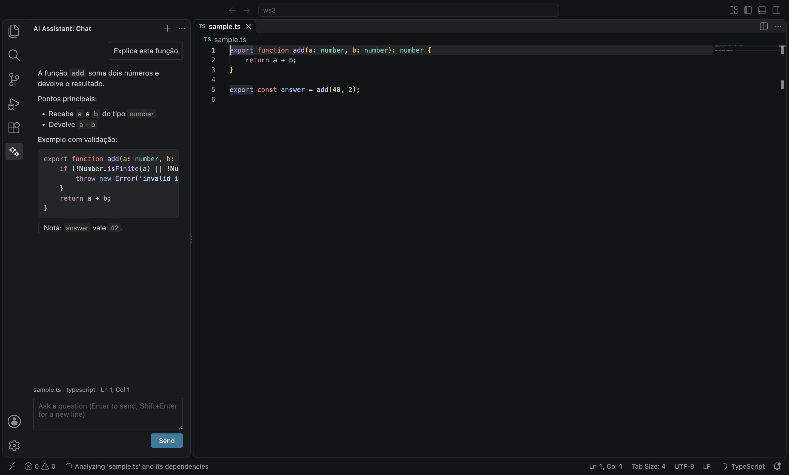
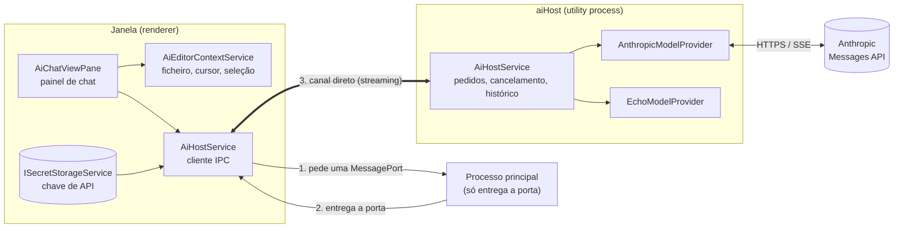

# IDE_OpenSource

Um editor de código com IA integrada no núcleo, construído a partir do [VS Code Open Source ("Code - OSS")](https://github.com/microsoft/vscode).

Em vez de uma extensão, o assistente de IA faz parte do próprio editor: tem um painel nativo na barra de atividades, lê em tempo real o ficheiro aberto, a posição do cursor e a seleção, e conversa com o modelo num processo separado, para que a interface nunca bloqueie.

> **Estado:** protótipo em desenvolvimento. Testado apenas em macOS (Apple Silicon). O nome do projeto é provisório.



---

## Índice

- [Funcionalidades](#funcionalidades)
- [Começar](#começar)
- [Configuração](#configuração)
- [Como usar](#como-usar)
- [Arquitetura](#arquitetura)
- [Estrutura do código](#estrutura-do-código)
- [Testes](#testes)
- [Privacidade e segurança](#privacidade-e-segurança)
- [Limitações conhecidas e próximos passos](#limitações-conhecidas-e-próximos-passos)
- [Manter atualizado com o VS Code](#manter-atualizado-com-o-vs-code)
- [Licença](#licença)

---

## Funcionalidades

**Painel de IA nativo**
- Ícone próprio na barra de atividades (*AI Assistant*), com uma vista de chat.
- Respostas em **streaming**, renderizadas como **Markdown** enquanto chegam.
- Blocos de código com **realce de sintaxe do próprio editor** (Monaco) e dois botões:
  - **Copy**: copia o código para a área de transferência.
  - **Insert at Cursor**: insere o código no editor ativo, substituindo a seleção. É uma única edição, que se desfaz com um Ctrl/Cmd+Z.
- Botão **Stop** para cancelar a resposta e **New Chat** para começar uma conversa nova.

**Contexto do editor em tempo real**
- O painel mostra o ficheiro ativo, a linguagem, a posição do cursor e quantos caracteres estão selecionados.
- Cada pergunta leva o caminho do ficheiro, a linguagem, o cursor, as seleções, o texto selecionado e o conteúdo do ficheiro (até 200 000 caracteres).
- Numa conversa, o conteúdo de um ficheiro só é reenviado quando muda, o que poupa tokens.

**Modelos Claude (Anthropic)**
- Integração com a Messages API em streaming, através do SDK oficial `@anthropic-ai/sdk`.
- Modelo por defeito: `claude-sonnet-5-5`, com nível de esforço configurável.
- Histórico de conversa com vários turnos.
- *Fallback* do lado do servidor: se o modelo recusar um pedido por política, a API tenta outro modelo na mesma chamada.
- *Cache* automático do prompt, para reduzir custo e latência em conversas longas.
- Fornecedor `echo` para testar sem rede nem custos.

**Interface limpa**
- O chat e o *Agent Host* de IA que vêm no VS Code estão desligados por defeito, por isso só aparece o nosso assistente.

---

## Começar

### Requisitos

| Ferramenta | Versão |
|---|---|
| Node.js | **24.18.0** (está no [`.nvmrc`](.nvmrc); recomendado usar o [nvm](https://github.com/nvm-sh/nvm)) |
| npm | < 13 (o `yarn` **não** é suportado) |
| Python | 3.x (para compilar módulos nativos) |
| macOS | Xcode Command Line Tools (`xcode-select --install`) |

Para Linux e Windows, segue os [pré-requisitos oficiais do VS Code](https://github.com/microsoft/vscode/wiki/How-to-Contribute#prerequisites).

### Instalar, compilar e executar

```bash
git clone https://github.com/FelipeFVM/IDE_OpenSource.git
```

```bash
cd IDE_OpenSource && git checkout ai-assistant
```

```bash
nvm install && nvm use
```

```bash
npm install
```

```bash
npm run compile
```

```bash
./scripts/code.sh
```

No Windows, usa `scripts\code.bat`. Na primeira execução, o script descarrega o Electron e as extensões built-in.

Durante o desenvolvimento, `npm run watch` recompila automaticamente a cada alteração. Depois basta recarregar a janela (*Developer: Reload Window*).

---

## Configuração

### Chave de API da Anthropic

1. Abre o Command Palette (Cmd/Ctrl+Shift+P).
2. Executa **AI Assistant: Set Anthropic API Key** e cola a chave (`sk-ant-…`).

A chave fica no armazenamento seguro do sistema operativo (Keychain no macOS, libsecret no Linux, DPAPI no Windows) e nunca é gravada nas definições. Para a remover, usa **AI Assistant: Clear Anthropic API Key**.

Se não houver chave guardada, o assistente usa as variáveis de ambiente `ANTHROPIC_API_KEY` ou `ANTHROPIC_AUTH_TOKEN`, se existirem.

### Definições

| Definição | Valor por defeito | Descrição |
|---|---|---|
| `aiAssistant.provider` | `anthropic` | `anthropic` para os modelos Claude; `echo` para testar offline. |
| `aiAssistant.model` | `claude-sonnet-5-5` | ID do modelo da Anthropic (por exemplo `claude-opus-5-5`). |
| `aiAssistant.effort` | `low` | Esforço por resposta: `low`, `medium`, `high`, `max`. Níveis mais altos pensam mais e custam mais. |

As alterações às definições e à chave aplicam-se de imediato, sem reiniciar.

**Para voltar a mostrar o chat do VS Code**, define `"chat.disableAIFeatures": false` e `"workbench.secondarySideBar.defaultVisibility": "visibleInWorkspace"`.

### Variáveis de ambiente úteis

| Variável | Uso |
|---|---|
| `ANTHROPIC_API_KEY` | Chave usada quando não há nenhuma guardada no editor. |
| `ANTHROPIC_BASE_URL` | Outro endpoint compatível com a Messages API, por exemplo um proxy ou um servidor de testes local. |

---

## Como usar

1. Abre um ficheiro no editor.
2. Clica no ícone **AI Assistant** (✨) na barra de atividades.
3. Opcionalmente, seleciona o trecho de código sobre o qual queres perguntar. A linha por cima do campo de texto mostra o contexto que vai ser enviado.
4. Escreve a pergunta e carrega em **Enter** (Shift+Enter cria uma nova linha).
5. Nos blocos de código da resposta, usa **Copy** ou **Insert at Cursor**.

| Comando | O que faz |
|---|---|
| AI Assistant: New Chat | Limpa a conversa (também está no botão **+** do painel). |
| AI Assistant: Set Anthropic API Key | Guarda a chave de API. |
| AI Assistant: Clear Anthropic API Key | Remove a chave de API. |

---

## Arquitetura

As chamadas ao modelo nunca correm no processo de interface (renderer) nem no processo principal. Correm num **utility process** dedicado, o `aiHost`, ao lado dos que o VS Code já usa para o *extension host*, o *file watcher* e o terminal.



**Como funciona:**
- **Um `aiHost` por janela.** O renderer cria-o na primeira pergunta, através do `IUtilityProcessWorkerWorkbenchService` do VS Code, o mesmo mecanismo que o editor usa para o *file watcher*. O processo termina quando a janela fecha.
- **Canal direto.** O processo principal só entrega uma `MessagePort`; depois disso, os tokens passam diretamente entre o `aiHost` e a janela.
- **Recuperação automática.** Se o `aiHost` terminar inesperadamente, o pedido seguinte cria um novo processo. Os pedidos que estavam a meio terminam com uma mensagem de erro.
- **O histórico vive no `aiHost`.** Só é registado um turno quando termina com sucesso, e as respostas anteriores (incluindo os blocos de *thinking*) voltam à API exatamente como vieram, como a API exige.
- **System prompt estável.** O contexto do editor vai dentro de cada mensagem do utilizador e o system prompt nunca muda, o que mantém o *cache* válido.

---

## Estrutura do código

Todo o código novo está em pastas próprias, separado do código do VS Code:

```
src/vs/platform/aiHost/
├── common/aiHost.ts                     contrato IAiHostService, tipos, definições
├── node/aiHostMain.ts                   ponto de entrada do utility process
├── node/aiHostService.ts                pedidos, streaming, cancelamento
├── node/aiModelProvider.ts              interface de fornecedor + EchoModelProvider
├── node/anthropicModelProvider.ts       integração com a Anthropic
└── test/node/                           testes unitários

src/vs/workbench/services/aiHost/
└── electron-browser/aiHostService.ts    cliente no renderer (cria o processo e envia a configuração)

src/vs/workbench/contrib/aiAssistant/
├── browser/aiAssistant.contribution.ts  registo do painel, definições, valores por defeito
├── browser/aiAssistantActions.ts        comandos (chave de API, New Chat)
├── browser/aiChatView.ts                painel de chat (Markdown, Copy, Insert)
├── browser/aiEditorContextService.ts    contexto do editor ativo
├── browser/media/aiAssistant.css        estilos
├── common/aiInsertCode.ts               regras de inserção de código
└── test/                                testes unitários
```

**Ficheiros do VS Code alterados** (mantidos ao mínimo para facilitar as atualizações):

| Ficheiro | Alteração |
|---|---|
| `src/vs/workbench/workbench.desktop.main.ts` | Importa o serviço e o painel. |
| `build/next/index.ts` | Inclui o `aiHostMain` no build de produção. |
| `build/lib/i18n.resources.json` | Regista a pasta do painel para traduções. |
| `eslint.config.js` | Permite ao `aiHost` importar o `@anthropic-ai/sdk`. |

---

## Testes

### Testes do AI Assistant

Primeiro, compila com `npm run compile`. Depois:

```bash
npm run test-node -- --run src/vs/platform/aiHost/test/node/anthropicModelProvider.test.ts
```

```bash
npm run test-node -- --run src/vs/platform/aiHost/test/node/aiHostService.test.ts
```

```bash
./scripts/test.sh --run src/vs/workbench/contrib/aiAssistant/test/browser/aiEditorContextService.test.ts --run src/vs/workbench/contrib/aiAssistant/test/common/aiInsertCode.test.ts
```

Os testes do fornecedor Anthropic correm o SDK verdadeiro contra um servidor HTTP local que simula a Messages API. Não precisam de chave nem fazem chamadas pagas.

**O que está coberto:**
- streaming, cancelamento, erros e recusas;
- o pedido enviado à API: modelo, esforço, fallback e cache;
- a conversa com vários turnos, incluindo o reenvio das respostas sem alterações e a omissão de ficheiros que não mudaram;
- o contexto do editor: cursor, seleções, ficheiros grandes e debounce;
- as regras do *Insert at Cursor*: quebras de linha e CRLF.

### Verificações do repositório

```bash
npm run typecheck-client
```

```bash
npm run eslint
```

```bash
npm run hygiene
```

```bash
npm run valid-layers-check
```

**Último resultado em macOS:**
- Passaram: typecheck, eslint completo, hygiene, stylelint, camadas de arquitetura, tsec, define-class-fields e ciclos de dependências.
- Suíte unitária completa em Node: 24 505 testes passaram.
- Suíte unitária completa em Electron: 54 364 testes passaram. Houve 6 falhas, todas em testes do AI Assistant; foram corrigidas e esse ficheiro de testes passa (14/14), mas a suíte completa ainda não foi repetida.

---

## Privacidade e segurança

**O que é enviado à Anthropic** a cada pergunta:
- a pergunta;
- o caminho e a linguagem do ficheiro ativo;
- a posição do cursor e as seleções;
- o texto selecionado;
- o conteúdo do ficheiro, até 200 000 caracteres.

Não abras ficheiros com segredos (como `.env`) enquanto perguntas ao assistente.

**Proteções:**
- **Chave de API:** fica no armazenamento seguro do sistema e só é entregue ao `aiHost`; nunca aparece nas definições nem nos logs.
- **Respostas:** são renderizadas como Markdown não confiável, sem HTML nem links para comandos.
- **Processos:** o `aiHost` corre isolado da interface e do processo principal.

---

## Limitações conhecidas e próximos passos

**Limitações atuais:**
- **Plataformas:** testado apenas em macOS. Linux e Windows ainda não foram testados.
- **Histórico:** perde-se ao fechar a janela, ou se o `aiHost` terminar inesperadamente.
- **Proxy:** o `aiHost` não usa as definições de proxy do VS Code, por isso pode falhar atrás de um proxy corporativo.
- **Anthropic real:** ainda não foi feito nenhum teste contra a API verdadeira; os testes usaram um servidor simulado.

**Próximos passos:**
- Guardar as conversas entre sessões.
- Aplicar sugestões diretamente como *diff* no editor.
- Suporte a modelos locais.
- Nome e identidade visual próprios (`product.json`).

---

## Manter atualizado com o VS Code

Este repositório é um fork do `microsoft/vscode`. Para trazer as novidades do VS Code:

```bash
git remote add upstream https://github.com/microsoft/vscode.git
```

```bash
git fetch upstream main
```

```bash
git merge upstream/main
```

Como o código novo está em pastas próprias, os conflitos devem limitar-se aos 4 ficheiros da tabela acima e a este `README.md`.

O README original do VS Code continua disponível no [repositório da Microsoft](https://github.com/microsoft/vscode/blob/main/README.md).

---

## Licença

Distribuído sob a [licença MIT](LICENSE.txt), tal como o VS Code Open Source.

Este projeto não é afiliado nem endossado pela Microsoft. "Visual Studio Code" é uma marca registada da Microsoft Corporation; o produto final deve usar nome e identidade próprios.
